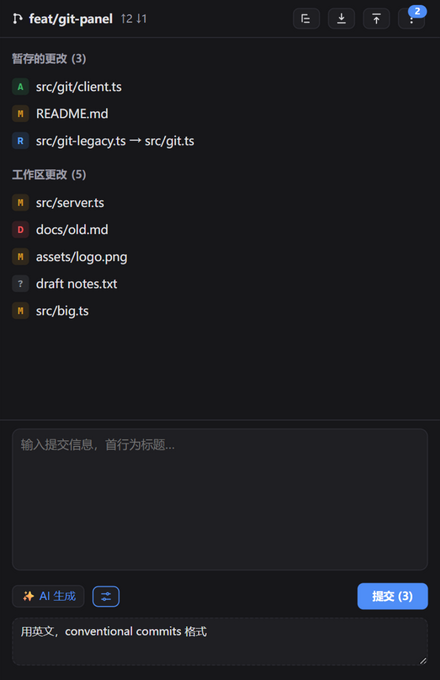
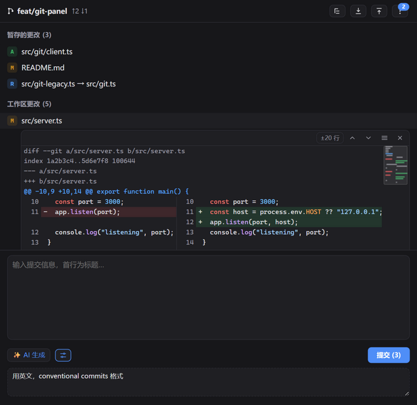

# zcode-plugin-git

Git workbench side panel for ZCode, built on MCP Apps — review, stage, and commit changes without leaving the chat, with AI-generated commit messages.

English | [简体中文](README.zh-CN.md)

## Features

- **Git side panel** — branches, ahead/behind, staged & working-tree changes (renames, conflicts, and untracked files included)
- **List & tree views** — collapsible directory tree with single-child chains merged (`a/b/c`); view preference remembered
- **Diff viewer** — inline unified diff per file, switchable side-by-side compare, adjustable context (±10 / ±20 lines / full file), previous/next change navigation, and a minimap overview (add/del coloring, viewport indicator, click/drag to jump)
- **Image compare** — image files open as an old-vs-new side-by-side preview across staged / worktree / HEAD versions (>2MB is skipped with a hint)
- **File actions** — stage, unstage, and discard (inline confirmation for destructive ones), plus bulk actions per section
- **Pull & stash** — one-click `git pull`; stash push (including untracked), pop, apply, and list with a count badge
- **AI commit messages** — generate Conventional Commits messages from the staged diff via host model sampling (`sampling/createMessage`), with an optional custom prompt; also available as the `/git:commit` slash command
- **Live updates** — status refreshes every 3s while the panel is visible; open diffs follow their files across stage/unstage

<p align="center">
  
  &nbsp;&nbsp;&nbsp;
  
</p>

## Requirements

- ZCode host with MCP Apps support
- Node.js ≥ 18
- `git` on PATH

## Install

Built artifacts are committed under `plugins/git/dist/`, so installing from a checkout needs no build step.

### Add as a marketplace source (recommended)

```bash
zcode plugins marketplace add https://github.com/wudx/zcode-plugin-git
```

Then install the **Git 工具** plugin from the marketplace and open the Git panel in the sidebar.

### From source

```bash
git clone https://github.com/wudx/zcode-plugin-git
cd zcode-plugin-git
npm install
npm run build
zcode plugins marketplace add /path/to/zcode-plugin-git
```

## Development

```bash
npm install                    # esbuild + MCP SDK (build-time only)
npm run build                  # bundle server + panel into plugins/git/dist/
npm run smoke                  # MCP protocol smoke tests against a temp git repo
node scripts/serve-panel.mjs   # open http://127.0.0.1:8137/mock to test the panel UI
```

After changing source, run `npm run build`, then refresh the marketplace and update the plugin in ZCode (source is not hot-reloaded).

## Project layout

```
marketplace.json                Marketplace manifest (add this repo as a source)
plugins/
  git/
    .zcode-plugin/plugin.json   Plugin manifest (sidebar surface + MCP server)
    commands/commit.md          /git:commit slash command
    icon.png
    server/server.mjs           MCP server source (14 git tools + panel resource)
    ui/src/                     Panel source (vanilla JS + @modelcontextprotocol/ext-apps)
    dist/                       Build output (committed — what actually runs)
      server.mjs                Bundled MCP server (zero runtime dependencies)
      ui/panel.html             Panel page with all JS/CSS inlined
scripts/
  build.mjs                     Build script
  smoke.mjs                     MCP protocol smoke tests
  serve-panel.mjs               Static server for the panel test bench
  mock-host.html                Mock ZCode host (ui/initialize + tool/sampling stubs)
```

## MCP tools

| Tool | Description |
| --- | --- |
| `git_status` | Branch, ahead/behind, staged/worktree/conflict file lists, stash count |
| `git_diff` | Single-file diff (`staged=true` for index vs HEAD; untracked files become an all-added diff; `scope=function`/`file` for wider context) |
| `git_stage` | `git add` |
| `git_unstage` | `git restore --staged` (equals `git rm --cached` before the first commit) |
| `git_discard` | Discard worktree changes / delete untracked files (dangerous) |
| `git_commit` | Commit the index (message read from stdin, multi-line UTF-8) |
| `git_log` | Recent commit history |
| `git_pull` | `git pull --no-edit` |
| `git_push` | Push the current branch to its upstream (sets upstream with `-u` automatically for new branches) |
| `git_stash` | `git stash push -u` (includes untracked files) |
| `git_stash_pop` | Pop the latest stash entry |
| `git_stash_apply` | Apply a stash entry (keep it) |
| `git_stash_list` | List stash entries (ref + subject) |
| `git_blob` | Read a file's content at worktree/index/HEAD (images as base64 for panel preview) |

## License

[MIT](LICENSE)
