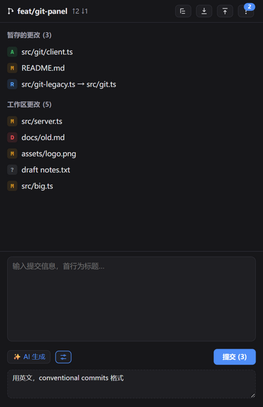
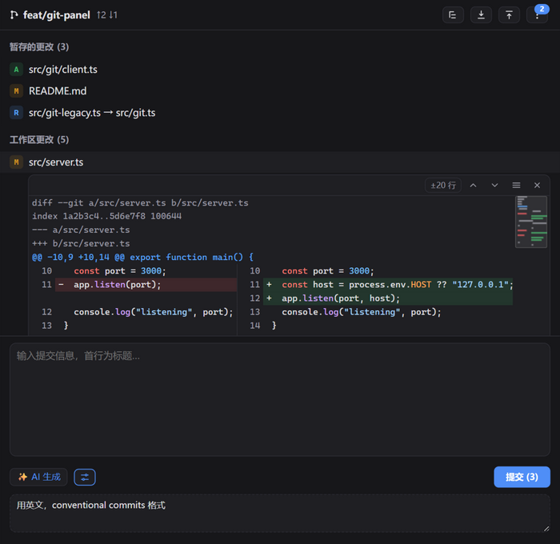

# zcode-plugin-git

ZCode 的 Git 工作台侧栏面板，基于 MCP Apps —— 不离开聊天即可审查、暂存、提交改动，并支持 AI 生成提交信息。

[English](README.md) | 简体中文

## 功能

- **Git 侧栏面板** —— 分支、ahead/behind、暂存区与工作区修改（含重命名、冲突、未跟踪文件）
- **列表 / 树两种视图** —— 目录树可折叠，单链目录自动合并（`a/b/c`）；视图偏好记忆
- **Diff 查看器** —— 点击文件行内展开统一 diff，可切换并排对照视图，上下文范围可调（±10 / ±20 行 / 整个文件），上一个/下一个更改跳转，右侧迷你地图缩略条（增删着色、视口指示、点击/拖动定位）
- **图片比对** —— 图片文件自动切换为「旧版 | 新版」并排预览，覆盖暂存 / 工作区 / HEAD 三个版本（>2MB 提示跳过）
- **文件操作** —— 暂存、取消暂存、撤销（危险操作行内二次确认），分区头支持全部暂存 / 全部取消 / 全部撤销
- **拉取与存储** —— 一键 `git pull`；stash 存储全部改动（含未跟踪）、恢复、按条目应用、列表，按钮带数量角标
- **AI 生成提交信息** —— 基于暂存 diff 由宿主模型采样（`sampling/createMessage`）生成 Conventional Commits 风格信息，可附加自定义提示词；也可在聊天里用 `/git:commit` 斜杠命令
- **自动跟进** —— 面板可见时每 3s 刷新状态；已展开的 diff 在暂存/取消暂存后自动跟随迁移

<p align="center">
  
  &nbsp;&nbsp;&nbsp;
  
</p>

## 环境要求

- 支持 MCP Apps 的 ZCode 宿主
- Node.js ≥ 18
- 本机可用 `git`

## 安装

构建产物已提交在 `plugins/git/dist/`，从检出目录安装无需先构建。

### 添加为市场源（推荐）

```bash
zcode plugins marketplace add https://github.com/wudx/zcode-plugin-git
```

然后在市场里安装 **Git 工具** 插件，打开侧栏的 Git 面板即可。

### 从源码安装

```bash
git clone https://github.com/wudx/zcode-plugin-git
cd zcode-plugin-git
npm install
npm run build
zcode plugins marketplace add /path/to/zcode-plugin-git
```

## 开发

```bash
npm install                    # 安装 esbuild + MCP SDK（仅构建期）
npm run build                  # 打包 server + panel 到 plugins/git/dist/
npm run smoke                  # MCP 协议冒烟测试（临时 git 仓库）
node scripts/serve-panel.mjs   # 浏览器打开 http://127.0.0.1:8137/mock 实测面板 UI
```

改动源码后先 `npm run build`，再在 ZCode 里刷新市场并更新插件（源码不会热加载）。

## 目录结构

```
marketplace.json                市场清单（把本仓库添加为市场源即用）
plugins/
  git/
    .zcode-plugin/plugin.json   插件 manifest（侧栏面板 + MCP server）
    commands/commit.md          /git:commit 斜杠命令
    icon.png
    server/server.mjs           MCP server 源码（14 个 git 工具 + 面板资源）
    ui/src/                     面板源码（vanilla JS + @modelcontextprotocol/ext-apps）
    dist/                       构建产物（已入库，实际运行的文件）
      server.mjs                打包后的 MCP server（零运行时依赖）
      ui/panel.html             内联全部 JS/CSS 的面板页
scripts/
  build.mjs                     构建脚本
  smoke.mjs                     MCP 协议冒烟测试
  serve-panel.mjs               面板测试床静态服务
  mock-host.html                Mock ZCode 宿主（ui/initialize + 工具/采样桩）
```

## 工具清单（MCP）

| 工具 | 说明 |
| --- | --- |
| `git_status` | 分支、ahead/behind、暂存/工作区/冲突文件列表、stash 数量 |
| `git_diff` | 单文件 diff（`staged=true` 为暂存区 vs HEAD；未跟踪文件合成全新增 diff；`scope=function`/`file` 显示更大范围） |
| `git_stage` | git add |
| `git_unstage` | git restore --staged（首次提交前等价 git rm --cached） |
| `git_discard` | 撤销工作区修改 / 删除未跟踪文件（危险） |
| `git_commit` | 提交暂存区（-F - 读 stdin，UTF-8 多行信息） |
| `git_log` | 最近提交历史 |
| `git_pull` | git pull --no-edit |
| `git_push` | 推送当前分支到上游远程（新分支无上游时自动以 -u 建立跟踪后重推） |
| `git_stash` | git stash push -u（含未跟踪文件） |
| `git_stash_pop` | 恢复最近一次存储并移除条目 |
| `git_stash_apply` | 应用指定条目（保留） |
| `git_stash_list` | stash 列表（ref + 说明） |
| `git_blob` | 读取文件在 worktree/index/HEAD 版本的内容（图片 base64，供面板预览） |

## 许可证

[MIT](LICENSE)
